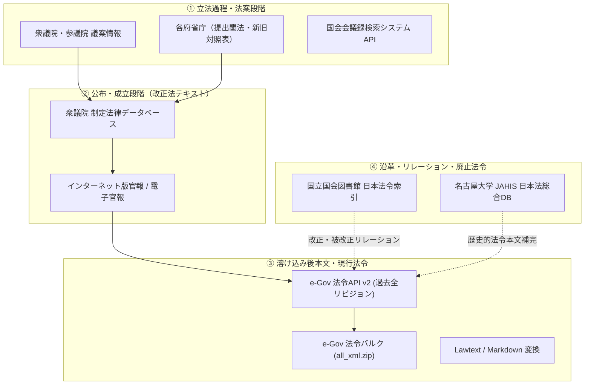

# 日本の法令データソース調査レポート (SOURCES.md)

日本の法令の差分・来歴を Git で追跡可能にするプロジェクト（`gitlaw-jp`）において活用可能なデータソース、構造化データ、バルクデータ、およびそれらの取得・統合方針に関する調査報告書。

---

## 1. 背景と課題

### 1.1 先行事例との比較と本プロジェクトの立ち位置

日本の法律を Git で管理する試みとして先行するプロジェクト（例: `houritsu-japanese-laws-as-git` 等）は、「GitHub 上で法令の差分（`git diff`）が Markdown で閲覧できる」という点で広く支持を集めました。しかし、技術的・法制執務的には以下の大きなトレードオフ（単純化）を抱えています。

| 観点 | 単一ブランチ・直列モデル（先行事例） | `gitlaw-jp`（Dual Projection モデル） |
| :--- | :--- | :--- |
| **グラフ構造** | 施行日を基準とした 1 本の線形履歴 | **公布投影（PR/マージ風 DAG）** と **施行投影（線形タイムライン）** の 2 系統 |
| **改正単位の捉え方** | 単一法令の施行日コミット | **改正法（AmendmentEvent）単位**。1 回の改正で複数法令が変わる「束ね法」を表現 |
| **公布と施行の乖離** | 施行日のみを追うため、公布先行や段階施行（N段ロケット）の法的事実が抜け落ちる | 公布と施行を独立して投影し、時点（`as_of`）や段階的施行を厳密に管理 |
| **改正法自体の本文** | 溶け込み後の条文のみ存在し、「改め文」そのものは失われる | 改正法そのものの成立・公布テキストをコミットまたはメタデータとして保持可能 |

本プロジェクトが目指すのは、単なるテキストビューアにとどまらない、**日本の立法実態（法案提出 → 審議 → 可決・公布 → 段階的施行）を忠実に表現する本格的なバージョン管理基盤**です。

---

## 2. データソースの体系的分類

日本の法令データは単一の機関で一括管理されておらず、ライフサイクル（立法〜公布〜施行〜過去履歴）に応じて管理主体が分かれています。



---

## 3. 主要データソースの詳細仕様

### 3.1 法令本文（溶け込み後）および過去リビジョン

#### ① e-Gov 法令バルクデータ (`all_xml.zip`)
* **提供元**: デジタル庁
* **URL**: `https://laws.e-gov.go.jp/`
* **形式**: XML (`XMLSchemaForJapaneseLaw_v3.xsd`), CSV (`all_law_list.csv`)
* **特徴**:
  * 現行施行中および直近の未施行法令の溶け込み後本文を網羅。
  * 約 250MB〜270MB の単一 ZIP で取得可能。
* **課題・制約**:
  * 各法令の「最新版」と「未施行版」のみが同梱されており、**過去の中間リビジョン（昭和・平成初期など）の XML は含まれない**。
  * 廃止された過去の法令（旧法）は含まれない。

#### ② e-Gov 法令API Version 2
* **提供元**: デジタル庁
* **仕様ドキュメント**: [Swagger UI](https://laws.e-gov.go.jp/api/2/swagger-ui), OpenAPI 3.0
* **認証**: 不要（事前登録なしでアクセス可能）
* **重要エンドポイント**:
  * `GET /law_revisions/{law_id_or_num}`: 対象法令の全改正履歴（過去〜未施行）と `law_revision_id` 一覧を取得。
  * `GET /law_data/{law_revision_id}`: **指定したリビジョン時点の溶け込み後 XML を直接取得**。
* **評価**:
  * バルク ZIP で欠落している「過去の全世代の法令 XML」をオンデマンドで補完できる最重要 API。

#### ③ 名古屋大学 JAHIS「日本法総合データベース」 (`law_data.zip`)
* **提供元**: 名古屋大学法情報研究センター
* **形式**: XML (独自スキーマ), CSV
* **収録範囲**: 明治19年（1886年）〜平成29年（2017年）
* **評価**:
  * e-Gov に存在しない戦前・明治期の歴史的法令や、すでに廃止された旧法の全文 XML を保有。
  * ※すでに `src/sources/lawdb.py` としてパイプラインへの組み込みが進められている。

---

### 3.2 「改正法そのもの（改め文）」の本文ソース

#### ① 衆議院「制定法律」データベース
* **提供元**: 衆議院
* **URL**: [https://www.shugiin.go.jp/internet/itdb_housei.nsf](https://www.shugiin.go.jp/internet/itdb_housei.nsf)
* **形式**: HTML
* **収録範囲**: **第1回国会（昭和22年/1947年）〜現代までのすべての制定法律**
* **特徴**:
  * 国会で可決・公布されたすべての法律の本文が回次・法律番号順に完全網羅。
  * 「〇〇法の一部を改正する法律」の**改め文本体、附則（施行期日・経過措置規定）がそのままテキストとして入手可能**。
* **活用方針**:
  * 公布投影の `AmendmentEvent` コミットにおいて、対象法令の XML だけでなく、改正法自体のテキスト（`amendments/<law_num>.txt` 等）を保存する一次ソースとして最適。

#### ② インターネット版官報 / 電子官報
* **提供元**: 独立行政法人 国立印刷局 / 内閣府
* **URL**: [https://kanpou.npb.go.jp/](https://kanpou.npb.go.jp/)
* **形式**: PDF, HTML（直近90日間は無料公開）
* **特徴**:
  * 2025年4月1日の「官報の発行に関する法律」施行に伴い、紙から**電子データが「正本」**へと移行。
  * 法律だけでなく、政令・省令・告示の改正原文（改め文）を入手可能。
* **課題**:
  * 過去分の全件取得には有料データベース（官報情報検索サービス）または定期的な日次クローリングが必要。

---

### 3.3 立法過程・法案・国会審議メタデータ

#### ① 国立国会図書館「日本法令索引」
* **提供元**: 国立国会図書館 (NDL)
* **URL**: [https://hourei.ndl.go.jp/](https://hourei.ndl.go.jp/)
* **形式**: Web (公式の公開 Web API は現時点で未提供)
* **特徴**:
  * 明治19年以降の日本の全法令の改廃経過の決定版。
  * **「改正法令（親）」と「被改正法令（子）」のリレーション**が完全に整理されている。
  * 国会審議（提出回次、議案番号、委員会、本会議採決日、官報号数）へのリンクを網羅。
* **活用方針**:
  * 改正法令番号から「どの法律が同時に改正されたか」を網羅的に特定する名寄せ・リレーション辞書として活用。

#### ② 国会会議録検索システム API
* **提供元**: 国立国会図書館
* **URL**: [https://kokkai.ndl.go.jp/api.html](https://kokkai.ndl.go.jp/api.html)
* **形式**: Web API (XML / JSON)
* **特徴**:
  * 国会の本会議・委員会における全発言録を検索・取得可能。
* **活用方針**:
  * 法案提出理由説明や審議の要約をコミットメッセージや PR の Description に自動注入可能。

#### ③ 各府省庁の国会提出法案（閣法）ページ
* **提供元**: 各省庁（法務省、財務省、デジタル庁など）
* **形式**: PDF
* **特徴**:
  * 「法律案要綱」「理由」「新旧対照条文（diff）」が公開されている。
  * 改め文を自前でパースせずとも、公式が作成した左右対照表の差分情報が得られる。

---

### 3.4 法令テキスト表現および解析ツール (OSS/研究)

#### ① yamachig/Lawtext
* **URL**: [https://github.com/yamachig/Lawtext](https://github.com/yamachig/Lawtext)
* **概要**: 日本の法令標準 XML をプレーンテキストで可視化・編集するためのフォーマットおよびパーサー。
* **利点**: XML 特有の冗長さを排除し、Git の line-based diff で自然に比較できるように設計されている。VSCode 拡張やブラウザビューアも存在。

#### ② LawHub（2020年・先行事例）の教訓
* **概要**: 衆議院の法案（改め文）をパースし、現行法に対するプルリクエストとして可視化を試みた Web サービス。
* **開発停止の理由**: 改め文の構文解析の複雑性（附則での例外規定や複数階層の改め文の解釈）が高すぎたこと、および各省庁の新旧対照表 PDF の普及。
* **教訓**: **「改め文を機械的にパッチ当てして溶け込み後本文を自作する」アプローチは極めて筋が悪い。** 溶け込み後本文は e-Gov API や JAHIS などの公式・準公式データを採用し、改め文は「改正の根拠テキスト（コミットメタデータ）」として保持するのが堅牢。

---

## 4. `gitlaw-jp` への統合アーキテクチャ設計

現在の `gitlaw-jp` の Dual Projection モデルに、これらデータソースを以下のようにマッピングすることを提案します。

```text
[衆議院 制定法律 / 官報]        [e-Gov API v2 / バルク]
    (改正法テキスト)             (溶け込み後本文 XML)
          │                               │
          ▼                               ▼
  ┌─────────────────┐             ┌─────────────────┐
  │ AmendmentEvent  │             │ EnforcementUnit │
  │ (改正法メタデータ)│             │ (法令版単位)     │
  └────────┬────────┘             └────────┬────────┘
           │                               │
           ▼                               ▼
  【公布投影 (DAG)】              【施行投影 (Linear)】
  refs/heads/<run>/promulgations  refs/heads/<run>/enforcements
  ├─ 改正法本文の記録             ├─ 溶け込み後本文の時系列
  ├─ 束ね法の一括マージ           └─ 有効状態 (as_of) フィルタ
  └─ 国会審議リンク
```

### 4.1 格納ディレクトリ構造の拡張案

```text
laws/
  {law_id[:3]}/{law_id}/
    current.xml          <- 溶け込み後 XML (e-Gov / JAHIS)
    current.json         <- メタデータ (法令ID, 版ID, 施行日)
    current.md           <- (追加推奨) GitHub Web 閲覧用 Markdown
amendments/
  {era}/{amendment_law_num}/
    original.txt         <- (追加) 衆議院「制定法律」から取得した改正法原文 (改め文)
    meta.json            <- 審議回次、公布日、対象被改正法令リスト、国会会議録URL
```

---

## 5. 段階的実装ロードマップ

### Phase 1: 即効性のある基盤強化（低コスト・高インパクト）
1. **GitHub Web UI 対策 (`current.md` 出力)**:
   - `06_git_sink` において、`current.xml` と同時に簡易 Markdown（または Lawtext）を生成してコミット。
   - これにより、和田氏の `houritsu` と同様に GitHub のブラウザ上で即座に diff が確認可能になる。
2. **e-Gov API v2 による過去リビジョン補完 (`EgovRevisionSource`)**:
   - バルク ZIP に含まれない過去の改正履歴を `GET /law_revisions` および `GET /law_data` 経由でオンデマンド取得・キャッシュするアダプタを追加。

### Phase 2: 改正法テキストの統合
1. **衆議院「制定法律」スクレイパーの実装**:
   - 第1回国会以降の制定法律 HTML から、法律番号・法律名・公布日・本文テキストを抽出してローカルキャッシュ化。
2. **公布コミットへの改正法本文の埋め込み**:
   - `AmendmentEvent` コミットの tree に `amendments/.../original.txt` を含め、「改正法そのものの差分」と「溶け込みの差分」を 1 つの PR/マージコミットで確認可能にする。

### Phase 3: メタデータと審議過程の連携
1. **日本法令索引による束ね法名寄せ**:
   - 改正法令番号をキーに、同一改正法によって改定された全法令の網羅性を検証。
2. **国会会議録検索 API 連携**:
   - コミットメッセージの Trailers に `Diet-Session`, `Bill-Id`, `Debate-URL` などを付与。
